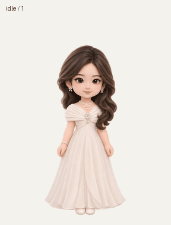

# zfl · Windows 独立桌宠

白色礼裙、侧分卷发与珍珠首饰的 Q 版动画桌宠。免安装，动画和图标都内置在 EXE 中，可离线使用。

**[下载 Windows x64 桌宠 ZIP](downloads/zfl-Windows-x64.zip?raw=true)** · [直接下载 EXE](downloads/zfl.exe?raw=true)



## 使用

1. 下载 ZIP 并解压，双击 `zfl.exe`。
2. 按住人物拖动；单击挥手，双击跳跃。
3. 右键人物或任务栏托盘图标，可暂停自动走动、切换大小或置顶状态、找回桌宠和退出。

支持 Windows 10/11 64 位及 .NET Framework 4.8 或更新版本。程序不需要 Python 或 Node.js，不要求管理员权限。大小、位置和走动设置会保存在 `%LOCALAPPDATA%\ZflDeskPet\settings.json`。程序没有开机自启、联网对话或后台服务。

## 动画与实现

共有 31 帧：待机眨眼6帧、向右走8帧、向左走8帧、挥手4帧、跳跃5帧。图片通过图像生成制作，随后按完整姿态分组提取并统一配准；实际跳跃离地42像素，落地与待机基线相差1像素。

程序使用 C# / Windows Forms 与 Win32 `UpdateLayeredWindow` 实现每像素透明显示。透明区域允许点击穿过，保留人物部分的鼠标互动；支持托盘菜单、多屏工作区边界、三种尺寸和单实例运行。

## 源码与重建

- `source/`：应用源码与 DPI / 权限清单。
- `assets/`：精灵图、帧时长和图标。
- `qa/`：资源检查和 Windows 运行检查结果。
- `downloads/`：可直接运行的 EXE、ZIP 和 SHA-256 校验值。

在 Windows PowerShell 运行 `.\build.ps1` 即可使用系统自带的 .NET Framework C# 编译器重建。

运行检查示例：

```powershell
.\downloads\zfl.exe --self-test --config-dir .\test-config --report .\runtime-test.json --screenshot .\native-frame.png
```

运行检查使用隐藏窗口，检查真实的 Windows 图层绘制调用、鼠标命中测试、动画切换、走动位置、菜单操作、尺寸切换、屏幕边界、设置读写与 GDI 资源释放。它不等同于人工在所有 Windows 版本上的完整交互验收。
